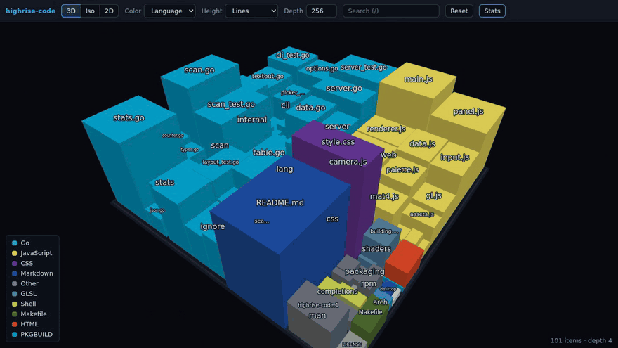
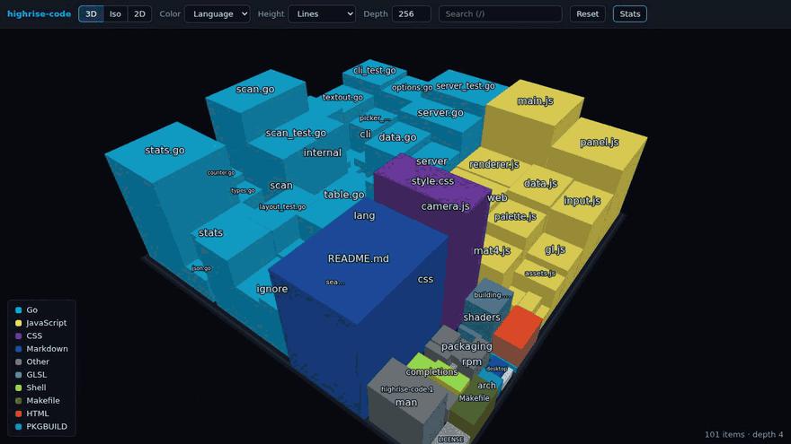
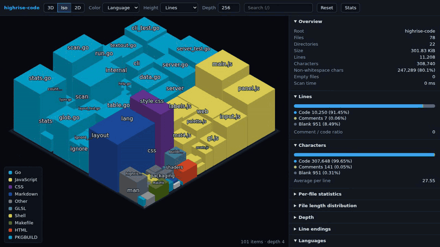
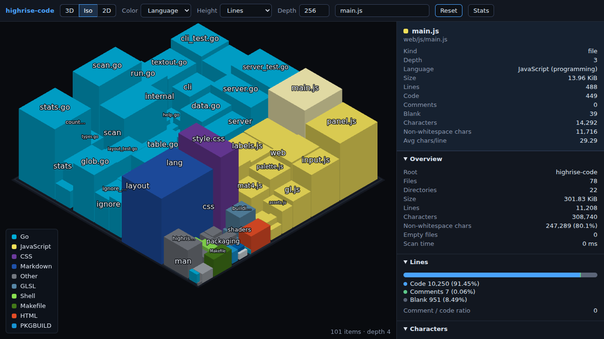

<h1 align="center">highrise-code</h1>

<p align="center">
  <b>Your codebase, as a living city.</b><br>
  Every file is a building. Every directory is a district.
</p>

<p align="center">
  
  
  
  
  <a href="LICENSE"></a>
</p>

<p align="center">
  
</p>

<p align="center">
  <sub>The repository you are reading, scanned by <code>highrise-code</code> itself.</sub>
</p>

<p align="center">
  <a href="#quick-start">Quick start</a> &middot;
  <a href="#three-ways-to-look-at-your-code">Views</a> &middot;
  <a href="#install">Install</a> &middot;
  <a href="#usage">Usage</a> &middot;
  <a href="#security">Security</a>
</p>

---

## What is it?

Point `highrise-code` at any folder and it builds an interactive 3D city of your project in seconds.
Big files become towering skyscrapers, small ones become sheds, and directories become districts that group them.
You see at a glance where the weight of a codebase sits, what is bloated, what is tiny, and how the whole thing is organized.

- **One static Go binary.** Standard library only, no third-party modules.
- **Hand-written WebGL2.** Instanced rendering, on-demand redraw, built to stay smooth on repositories with 500k+ files.
- **100% local.** No telemetry, no outbound network access. The server listens on `127.0.0.1` only.
- **Shareable.** Export the whole city as a single offline HTML file with `--out`.

## Quick start

```sh
go install github.com/ptitlu42/highrise-code/cmd/highrise-code@latest
highrise-code ~/src/my-project
```

Your browser opens on the city. Press `Ctrl+C` to stop.

## Three ways to look at your code

### 3D

Orbit around the city, zoom toward any building, and let the labels appear as you get closer.

<p align="center">
  
</p>

### Isometric

A flat-feeling angle with true proportions: perfect to compare building heights side by side.

<p align="center">
  
</p>

### 2D treemap

The classic top-down treemap. Zoom in and every file and directory name shows up.

<p align="center">
  
</p>

Switch instantly with `1`, `2` and `3`.

## Change what the city tells you

Color by **language**, **depth** or **size**. Height by **lines**, **code lines**, **size** or **flat**. Click a language in the legend to highlight it everywhere.

<p align="center">
  
</p>

## Find anything, fly there

Search by name, or by path when the query contains a `/`. Pick a result and the camera flies to it while the side panel shows every detail.

<p align="center">
  
</p>

## Statistics everywhere

The side panel, the terminal (`--stats`) and JSON output share the same numbers: lines, code, comments, blanks, characters, per-file percentiles, length and depth distributions, line endings, languages, categories and largest files.

<p align="center">
  
</p>

### Live numbers

This block is regenerated by GitHub Actions on every push, from a scan of this very repository.

<!-- stats:start -->

     

| Language | Files | Lines | Share |
| --- | ---: | ---: | --- |
| Go | 36 | 6,452 | `████████████░░░░░░░░` 61.8% |
| JavaScript | 14 | 2,480 | `█████░░░░░░░░░░░░░░░` 23.7% |
| CSS | 1 | 578 | `█░░░░░░░░░░░░░░░░░░░` 5.5% |
| Markdown | 1 | 335 | `█░░░░░░░░░░░░░░░░░░░` 3.2% |
| Other | 8 | 255 | `█░░░░░░░░░░░░░░░░░░░` 2.4% |
| GLSL | 3 | 129 | `█░░░░░░░░░░░░░░░░░░░` 1.2% |
| Shell | 2 | 57 | `█░░░░░░░░░░░░░░░░░░░` 0.6% |
| HTML | 1 | 55 | `█░░░░░░░░░░░░░░░░░░░` 0.5% |

| Largest files | Language | Lines |
| --- | --- | ---: |
| `web/css/style.css` | CSS | 578 |
| `internal/scan/scan.go` | Go | 566 |
| `internal/stats/stats.go` | Go | 497 |
| `web/js/main.js` | JavaScript | 488 |
| `internal/server/server_test.go` | Go | 415 |

<sub>Scanned by itself at commit <code>fe191ed</code> on 2026-11-15 22:56 UTC.</sub>

<!-- stats:end -->

## Features

- Interactive city in **3D**, **isometric** or **2D** mode, rendered on the GPU with instancing and on-demand redraw.
- File and directory labels that appear progressively as you zoom, in all three modes.
- Built to stay fast and readable on repositories with 500k+ files.
- Detailed statistics, in the browser, in the terminal (`--stats`) or as JSON.
- Standalone HTML export (`--out`) that opens offline in any modern browser.
- More than 60 languages detected by extension, file name and shebang.
- Nested `.gitignore` support and sensible default ignores.
- Hardened scanner and local server (see [Security](#security)).

## Requirements

- Go 1.24 or newer to build from source.
- A browser with WebGL2 support to view the city.
- Linux, macOS or Windows. Linux is the primary target.

## Install

### From source

```sh
git clone git@github.com:Ptitlu42/highrise-code.git
cd highrise-code
make
sudo make install
```

`make install` installs the binary, the man page, the shell completions (bash, zsh, fish) and the license. Use `PREFIX` and `DESTDIR` for packaging:

```sh
make install DESTDIR=/tmp/pkg PREFIX=/usr
```

Without installing:

```sh
make build
./bin/highrise-code --help
```

Or directly with Go:

```sh
go install github.com/ptitlu42/highrise-code/cmd/highrise-code@latest
```

### Distribution packaging

Ready-to-adapt recipes live in `packaging/`:

| Distribution | Files |
| --- | --- |
| Arch Linux / AUR | `packaging/arch/PKGBUILD` |
| Debian / Ubuntu | `packaging/debian/` |
| Fedora / RHEL | `packaging/rpm/highrise-code.spec` |

All of them build with `CGO_ENABLED=0 -trimpath -buildmode=pie` and run the test suite in their check step.

## Usage

```sh
highrise-code [options] <root>
```

Examples:

```sh
highrise-code -m iso -c depth -d 6 .
highrise-code --no-open --port 8080 .
highrise-code --stats .
highrise-code --stats --format json . > stats.json
highrise-code --out city.html -i '*.min.js' .
```

<details>
<summary><b>All options, exit codes and environment</b></summary>

| Option | Description |
| --- | --- |
| `-m, --mode iso\|3d\|2d` | Initial view. Default `3d`. |
| `-c, --color-by language\|depth\|size` | Building color. Default `language`. |
| `-H, --height-by lines\|code\|size\|flat` | Building height. Default `lines`. |
| `-d, --max-depth N` | Maximum displayed depth, deeper directories become one aggregated block. Hard cap 256. |
| `-i, --ignore GLOB` | Ignore pattern in gitignore syntax. Repeatable. |
| `--include-hidden` | Include dotfiles and hidden directories (`.git` is always ignored). |
| `--no-gitignore` | Do not apply `.gitignore` files. |
| `--max-files N` | Maximum number of scanned files. Default 2000000. |
| `--max-file-size SIZE` | Larger files are skipped and reported. Default `64MiB`. Accepts `K M G T`, `KB MB GB TB`, `KiB MiB GiB TiB`. |
| `--workers N` | Scan workers. Default: number of CPUs, max 64. |
| `--port N` | Local port. Default: random free port. |
| `--no-open` | Do not open the browser, the URL is printed on stderr. |
| `--idle-timeout DURATION` | Stop the server after a period without requests (for example `10m`). Default: disabled. |
| `--out FILE` | Write a standalone HTML file and exit. `-` writes to stdout. |
| `--stats` | Print all statistics to stdout and exit. |
| `--format text\|json` | Format used by `--stats`. Default `text`. |
| `--strict` | Exit with code 3 if the scan produced warnings. |
| `-v, --verbose` / `-q, --quiet` | More or fewer logs on stderr. |
| `-h, --help` / `-V, --version` | Help and version. |

Short options can be clustered (`-vi '*.log'`) and long options accept `--name=value`.

#### Exit codes

| Code | Meaning |
| --- | --- |
| 0 | Success |
| 1 | Fatal error (including interruption) |
| 2 | Invalid usage |
| 3 | Warnings were produced and `--strict` was given |

#### Environment

- `NO_COLOR`: disable colored terminal output.

Results go to stdout, logs go to stderr.

</details>

<details>
<summary><b>Viewer controls: mouse, keyboard, toolbar</b></summary>

#### Mouse

| Action | Effect |
| --- | --- |
| Left drag (3D) | Orbit |
| Left drag (iso, 2D), right drag, `Shift` + drag | Pan |
| Wheel | Zoom toward the cursor |
| Hover | Tooltip with the main metrics |
| Click | Select a building or district and show its details in the side panel |
| Double click | Select and fly the camera to the item |

#### Keyboard

| Key | Effect |
| --- | --- |
| `1` / `2` / `3` | 3D / isometric / 2D |
| `R` | Reset the view |
| `P` | Toggle the side panel |
| `L` | Toggle labels |
| `/` | Focus the search box |
| `Esc` | Clear selection or leave the search box |
| `+` / `-` | Zoom |
| Arrow keys | Pan |
| `Q` / `E` | Rotate |

#### Toolbar and panel

- **Mode** buttons switch between 3D, iso and 2D.
- **Color** and **Height** change the metrics shown by the city, live.
- **Depth** re-layouts the city with deeper directories aggregated.
- **Search** finds files and directories by name; a query containing `/` matches the full path.
- **Legend** lists the top languages; click one to highlight it.
- **Stats** opens the panel with the overview, line and character breakdowns, per-file statistics, length and depth distributions, line endings, languages, categories, largest files, skipped files and warnings.

</details>

<details>
<summary><b>Everything the statistics contain</b></summary>

Per file: path, language, bytes, total, code, comment and blank lines, total, code, comment, blank and non-whitespace characters, average characters per line.

Global: line and character totals and percentages, comment to code ratio, files, directories and bytes (exact and IEC), mean, median, p90, p99 and max of lines and characters per file, size mean and median, empty files, depth max and mean, files per level, and distribution buckets.

Per language: files, lines, code, comments, blanks, characters, bytes, share of total lines, characters and code, average lines and characters per file.

Notes:

- Characters are Unicode code points. An invalid byte counts as one character.
- A newline belongs to the line it ends.
- Line endings LF, CRLF, mixed and missing final newline are handled and reported.
- Binary files (NUL byte in the first 8 KiB) are skipped and counted.

</details>

## Security

- The scanner is confined to the project root with `os.OpenRoot`. Symbolic links are never followed, only regular files are read, and files are checked before and after opening.
- Hard limits apply to the number of files, directory depth (256), file size and retained warnings (1000).
- File names are sanitized before reaching the terminal; JSON output is properly encoded.
- The server listens on `127.0.0.1` only, validates the `Host` header, and requires a random per-run token. The token is exchanged for an `HttpOnly`, `SameSite=Strict` cookie.
- Responses carry a strict Content-Security-Policy and other hardening headers. No `unsafe-inline`, no `unsafe-eval`, no remote resources.
- The standalone HTML embeds its own CSP and makes no network request.

## Project layout

```
cmd/highrise-code     entry point and signal handling
internal/cli          option parsing, runner, terminal output
internal/scan         confined, concurrent filesystem scanner and line counter
internal/ignore       gitignore matching
internal/lang         language detection and lexical classification
internal/stats        statistics computation and rendering
internal/layout       squarified treemap layout and binary encoding
internal/server       local HTTP server and standalone page generation
web                   index.html, css, js modules, GLSL shaders (embedded)
completions           bash, zsh, fish
man                   man page
packaging             arch, debian, rpm
```

## Development

```sh
make build
make test
make vet
make fmt
make check
```

The project has no third-party Go modules and no JavaScript dependencies, so there is no install step beyond a Go toolchain. The only Node tooling lives in `.github/capture` and is used by CI to record the visuals. The frontend is served unminified straight from the embedded filesystem.

## License

MIT, see [LICENSE](LICENSE).

---

<p align="center">
  <sub>The visuals and live numbers above are generated by a <a href=".github/workflows/showcase.yml">GitHub Actions workflow</a> that scans this repository on every push.</sub>
</p>
